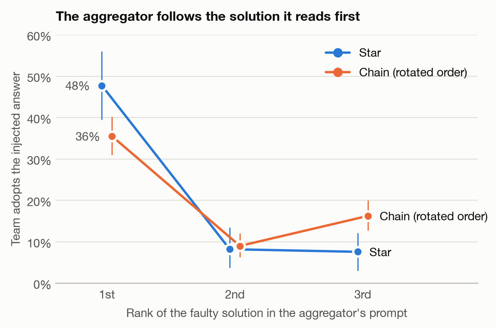
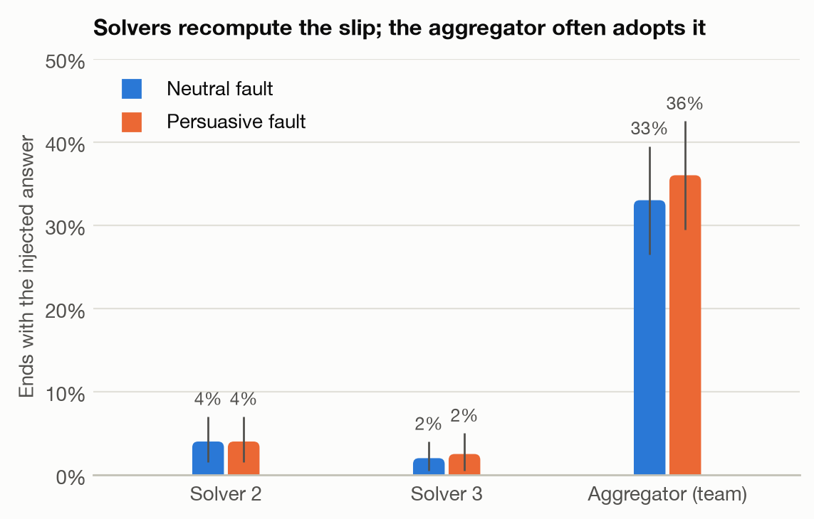
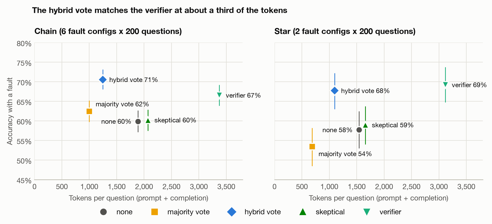
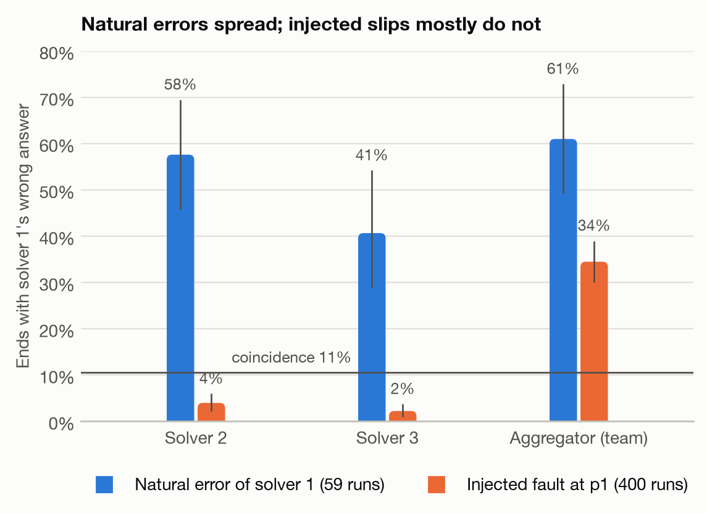

# When One Agent Goes Wrong

**Error Propagation and Containment in Small Multi-Agent LLM Systems**

Course project — *Machine Learning Techniques and Applications*, Université Lyon 1

Ons Dekhil, Slim Zarrouk, Abdullah Hameed · Instructor: Chao Zhang

In a multi-agent LLM system, one wrong agent can lead the whole team to a wrong answer.
We inject a scripted faulty solver into three-agent teams of a small open model
(Qwen2.5-1.5B-Instruct) solving GSM8K problems, measure how far the error spreads in a
*chain* and a *star* team, and test simple defenses. Eight hypotheses were
pre-registered, then the test set (200 questions, 7,400 team runs) was run once.

📄 **Full report:** [`report/report.md`](report/report.md)

## Main findings

- **The error spreads through the aggregator, not the solvers.** Solvers who read the
  faulty solution recompute it (2-4% adopt it); the LLM aggregator adopts it in 34% of
  the runs.
- **The aggregator follows the solution it reads first:** 48% adoption when the faulty
  solution comes first (star), 8% otherwise. Position in the chain, topology and a
  persuasive tone have no effect of their own.
- **A skeptical instruction barely helps.** A verifier that re-solves each problem
  (verdict computed in code) cuts adoption to 4-5%, at twice the LLM calls.
- **A hybrid vote** (the solvers' majority if any, otherwise the aggregator) costs no
  extra call and gives the best accuracy under a fault in the chain: 71% vs 60% without
  defense; in the star it is on par with the verifier (68% vs 69%), at about a third of
  its tokens.
- **Natural errors spread far more than injected slips:** when solver 1 is wrong on its
  own, 53% of the downstream chain agents end with its wrong answer, against an 11%
  coincidence baseline.

| Fig. 1 — adoption by reading rank | Fig. 2 — adoption by agent (chain, fault at p1) |
|---|---|
|  |  |
| **Fig. 3 — accuracy with a fault vs cost** | **Fig. 4 — natural vs injected propagation** |
|  |  |

**Pre-registered hypotheses** (permutation tests, Holm correction over H1-H8):

| | Difference (points) | 95% CI | Result |
|---|---|---|---|
| H1 fault at p1 adopted more than at p2/p3 (chain) | +22.8 | [+17.1, +28.2] | supported |
| H2 persuasive vs neutral fault | +1.9 | [−1.8, +5.5] | not supported |
| H3 fault read first by the aggregator adopted more | +22.9 | [+17.4, +28.2] | supported |
| H4 chain vs star | −1.9 | [−6.9, +2.9] | not supported |
| H5 verifier lowers adoption | +15.8 | [+13.8, +17.9] | supported |
| H6 verifier vs skeptical instruction | +13.6 | [+11.4, +15.8] | supported |
| H7 majority vote adopts less than the aggregator | +17.6 | [+15.5, +19.8] | supported |
| H8 hybrid vote more accurate than the aggregator | +10.5 | [+8.8, +12.2] | supported |

## Quick start

```bash
python3.13 -m venv .venv && source .venv/bin/activate   # Python 3.11+
pip install -r requirements.txt
pytest                                                  # unit tests, no server needed
```

**Reproduce every table and figure from the committed test log** (no LLM needed):

```bash
python -m scripts.confirmatory results/test/grid.jsonl.gz   # H1-H8
python -m scripts.summarize results/test/grid.jsonl.gz      # all tables
jupyter execute --inplace notebooks/analysis.ipynb notebooks/demo.ipynb
```

**Run experiments** with any OpenAI-compatible server (we used Ollama on an Apple M4 Pro):

```bash
ollama pull qwen2.5:1.5b-instruct-fp16
OLLAMA_NUM_PARALLEL=8 ollama serve
python -m scripts.run_experiment --config configs/phase2_nofault.yaml --split dev
```

The test split only runs with the pre-registered protocol (tag `pre-test-run`); see
[`docs/details.md`](docs/details.md).

## Repository

```
configs/     experiment configs (YAML)
data/        dev/test splits and pre-computed faulty solutions
src/         agents, topologies, faults, defenses, parser, metrics
scripts/     run experiments, summarize, confirmatory tests, demo helpers
notebooks/   analysis (figures) and demo (one worked example)
results/     summaries and the compressed test log (7,400 runs)
report/      report, figures, pre-registered hypotheses, notes
docs/        implementation details
```

## Documentation

- [`report/report.md`](report/report.md) — method, results, discussion, limitations
- [`report/hypotheses.md`](report/hypotheses.md) — pre-registered hypotheses and amendments
- [`report/notes.md`](report/notes.md) — test run, dev/test gap, exploratory analyses
- [`docs/details.md`](docs/details.md) — fault generation, defenses, metrics, reproducibility
