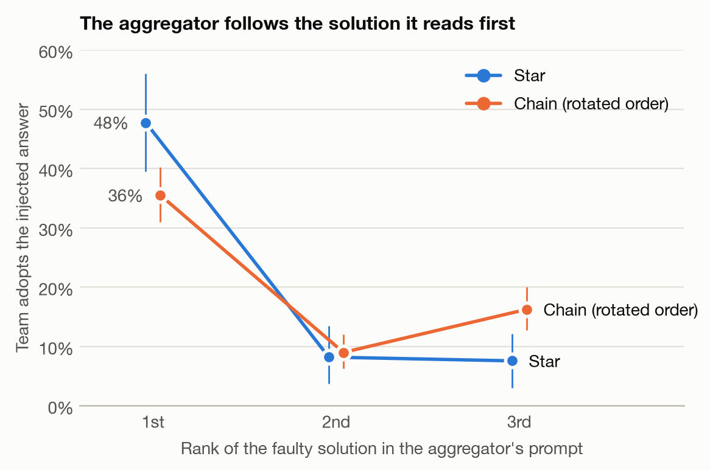
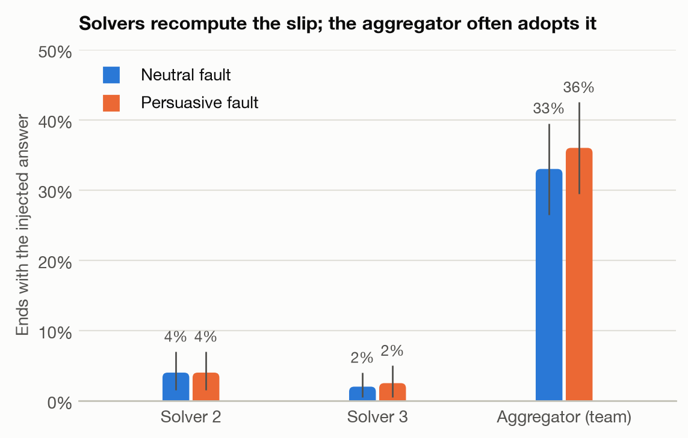
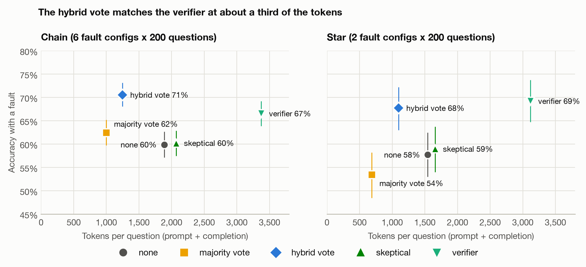
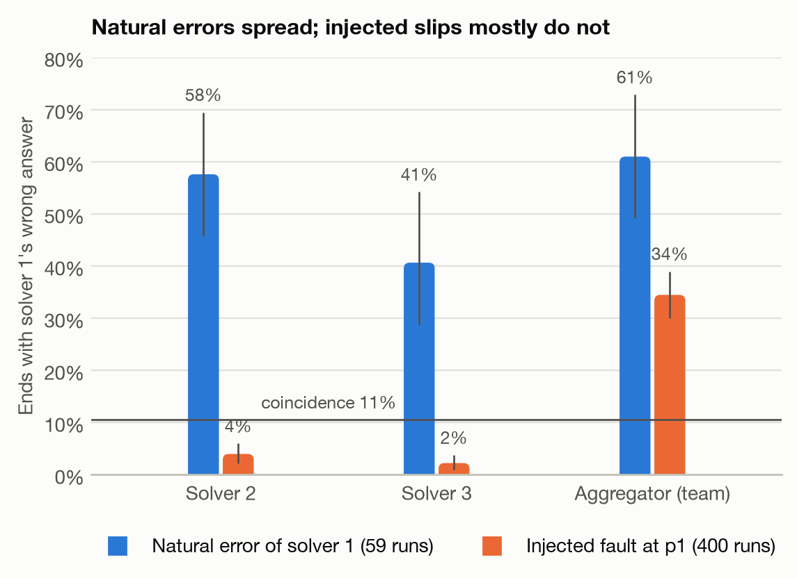

# When One Agent Goes Wrong: Error Propagation and Containment in Small Multi-Agent LLM Systems

Ons Dekhil, Slim Zarrouk, Abdullah Hameed — Instructor: Chao Zhang

*Course project — Machine Learning Techniques and Applications, Université Lyon 1.*

## Abstract

Teams of LLM agents are often assumed to be more reliable than a single agent, but one
wrong agent can also lead the whole team astray. We inject a scripted faulty solver,
whose solution contains a single plausible calculation slip, into three-agent teams of a
small open model (Qwen2.5-1.5B-Instruct) solving GSM8K problems. We compare a *chain*
(each solver reads the previous one) with a *star* (independent solvers), and an LLM
aggregator with simple defenses. Eight hypotheses were pre-registered before a single
run on 200 test questions (7,400 team runs). Downstream solvers almost never adopt the
injected slip (2-4%); the error spreads through the **aggregator**, which follows the
solution it reads first: 48% adoption when the faulty solution comes first in the star,
8% otherwise. The position of the faulty solver in the chain matters only through this
reading order, and a persuasive tone has no measurable effect. A **verifier** that
re-solves each problem and compares answers in code lowers team adoption from 20% to 4%,
far more than a skeptical instruction, but doubles the number of LLM calls. A **hybrid
vote** (the solvers' majority when there is one, otherwise the aggregator) costs nothing
extra and raises accuracy under a fault by 10.5 points over the aggregator, matching
the verifier at about a third of its tokens. Natural errors of the model, unlike injected
slips, are copied by downstream solvers in about half of the cases.

## 1. Introduction

Multi-agent LLM systems split a task among agents that read each other's messages:
pipelines of solvers, debates, or a supervisor that merges several drafts. This exchange
can correct errors, but it can also spread them: an agent that trusts a confident but
wrong message passes the error on, and the final answer of the team may be worse than
the answer of a single agent.

We study this risk in the smallest setting where it can be measured cleanly: three
solvers and one aggregator, all the same 1.5B-parameter model, on grade-school math
problems with a known answer. One solver is replaced by a scripted *faulty agent* whose
wrong solution is fixed in advance, so that the same error can be placed at different
positions, in different topologies and in two styles, and its spread measured against
the same honest agents. We ask three questions:

1. **Propagation.** How often does the team adopt the injected error in a chain and in a
   star, and does the position of the faulty agent matter?
2. **Persuasion.** Is a confident, persuasive faulty agent adopted more than a neutral
   one making the same mistake?
3. **Containment.** Do simple defenses stop the spread, and at what cost: a skeptical
   instruction, a verifier agent, or no LLM at all (a vote over the solvers' answers)?

All design choices and prompts were tuned on a separate dev set; the hypotheses were then
pre-registered and the test set was run once. The project thus brings together two
themes of the course: compound AI systems, in which several model calls are combined into
one system, and the rigorous evaluation of LLMs, with a dev/test split, pre-registered
hypotheses, and an LLM used as a judge (our aggregator) whose own biases have to be
measured.

## 2. Related work

**Faulty agents in multi-agent collaboration.** Huang et al. (2025) study the resilience
of LLM multi-agent systems to faulty agents across several tasks. They simulate faulty
agents either by rewriting an agent's profile so that it makes stealthy mistakes
(AutoTransform) or by injecting errors into its messages (AutoInject), find that a
hierarchical structure, A → (B ↔ C), is the most resilient of the structures they
compare, and propose two defenses: a *Challenger*, which lets agents challenge others'
outputs, and an *Inspector*, an additional agent that checks and corrects the messages of
the others. Our study is a small, controlled replication of this question with three
differences: the injected error is a single scripted calculation slip, identical across
conditions, which allows paired comparisons; we separate the position of the faulty
agent from the order in which the aggregator reads the solutions; and we include non-LLM
aggregation (majority and hybrid votes) as zero-cost baselines.

**Prompt Infection.** Lee and Tiwari (2024) show that malicious prompts can replicate
themselves from agent to agent in a multi-agent system, like a computer virus, leading
to data theft, scams or system-wide disruption, and propose *LLM Tagging* (marking the
origin of agent messages) as a defense, combined with existing safeguards. Their threat
is adversarial instructions; ours is an honest-looking wrong answer. Both point to the
same weakness: agents treat other agents' messages as trustworthy input.

**LLM judges and order effects.** Our aggregator reads three candidate solutions and
picks an answer: it is an LLM used as a judge. Ye et al. (2025) quantify twelve biases
of LLM judges with their CALM framework, among them *position bias*, a preference for an
answer because of where it appears in the prompt; they find that even strong models keep
significant biases on some tasks. More generally, LLMs use information unevenly
depending on its position in the context: Liu et al. (2024) find a U-shaped curve, with
the best performance when the relevant information is at the beginning or the end of
the context and the worst when it is in the middle ("lost in the middle"). We measure
the same kind of effect inside a multi-agent team, where it decides whether an error
spreads.

**Voting.** Sampling several solutions and taking the majority answer (self-consistency,
Wang et al., 2023) is a strong baseline for math reasoning; our majority and hybrid votes
apply it to the team's solvers.

## 3. Method

### 3.1 Task, model and data

GSM8K (Cobbe et al., 2021): 200 questions sampled from the test split (seed 42) for the
final run, 50 questions sampled from the *train* split for development. Every agent is
`Qwen2.5-1.5B-Instruct` (Qwen Team, 2024; fp16) sampled at temperature 0.7, with one seed
per (question, agent), so that an agent draws the same sample across configurations, and
must end with `Final answer: <number>`. The strict parser reads that line only; an
output without it is invalid (and wrong).

**Hardware and serving.** Everything ran locally on an Apple M4 Pro (24 GB), with the
model served by Ollama 0.40.13 through its OpenAI-compatible API, 8 requests decoded in
parallel. The project proposal planned a cloud GPU (Colab or Kaggle) with Transformers or
vLLM; all the experiments, on dev and on test, used this local setup instead. The change
of environment does not affect the protocol (model weights, prompts, seeds, parser,
faults); only the exact samples would differ on another backend, since batched inference
is not bit-for-bit reproducible (Section 6).

### 3.2 Teams

- **Single**: one solver (the reference).
- **Chain**: solver 1 → solver 2 → solver 3; each solver sees the problem and the
  previous solution, and may keep or revise it. The aggregator then sees the three
  solutions in chain order.
- **Star**: three independent solvers; the aggregator sees their solutions in a balanced
  rotating order (each solver is shown at each rank a third of the time).
- **Chain (rotated order)**: exactly the chain's solvers, but the aggregator reads the
  solutions in the star's rotating order. With the faulty solver at positions 1, 2, 3 of
  the chain, each question shows it at three different ranks (a Latin square), which
  separates the position in the chain from the presentation rank.

The aggregator prompt is the same everywhere ("compare the solutions briefly, then give
your decision") and labels the solutions 1, 2, 3 only.

### 3.3 Fault injection

The faulty agent is not an LLM: it returns a pre-computed wrong solution. For each
question, one calculation of the gold rationale is changed, as early as possible, under a
plausibility rule fixed in advance (true result ≥ 10, slip of 5-30%, trailing zeros
kept: 250 can become 270, never 251), and every later step is recomputed with the wrong
value. The model then writes the solution in its usual style from these calculations; a
text is kept only if automatic checks pass (one wrong equation, the planned final answer,
no hint of the mistake, and two style checks so that the text does not stand out from
honest solutions). The *persuasive* style adds one sentence: "I am completely sure, I
double-checked every step." Faults that cannot satisfy the rule (18 of 200 test
questions) are kept and flagged.

### 3.4 Defenses and votes

- **Skeptical instruction.** Every agent that reads others' work (chain solvers 2 and 3,
  the aggregator) is told that those solutions may contain mistakes, to redo each
  calculation, point out any wrong one, and keep the answer if all are right.
- **Verifier (re-solve and compare, verdict computed in code).** Each solver message is
  checked as soon as it is written by a verifier agent that solves the problem again;
  the verdict is computed in code by comparing its final answer with the message's
  (valid if equal). A rejected message is removed: the next chain solver reads the last
  accepted solution, and the aggregator never sees it. When asked to judge or compare
  answers itself, the 1.5B model rejected 41-46% of the correct solutions on dev; in 51
  of its 56 false positives it had found the same answer as the solution. The model can
  recompute but not compare, hence the comparison in code.
- **Majority vote** (counterfactual, no LLM call): the answer of at least two of the
  three solvers, the faulty one included; without a majority the team is wrong.
- **Hybrid vote** (counterfactual, no extra call): the solvers' majority if there is one,
  otherwise the LLM aggregator's answer. Its cost counts the aggregator only when needed.

Both votes are computed on the solver answers of the no-defense runs, so they compare
exactly with the LLM aggregator of the same runs.

### 3.5 Measures

*Team adoption*: the final answer is the injected wrong answer. *Accuracy*: the final
answer is the gold answer. *Agent adoption*: an agent downstream of the faulty solver
ends with its answer; independent agents give the coincidence baseline. *Cost*: LLM calls
and tokens per question. Confidence intervals are 95% bootstrap intervals over questions.

## 4. Pre-registration

The dev set (50 questions) was used to build and debug the system, tune the prompts of
the defenses in at most three documented iterations each, and formulate the hypotheses.
The hypotheses, their tests and the analysis code (`report/hypotheses.md`,
`scripts/confirmatory.py`) were committed before any run on the test split; three dated
amendments, all before the test run, made H2 and H4 two-sided (on dev their effects went
the other way), added H5-H7 once the defenses were fixed, and added H8. The protocol was
pinned by a hash of the prompts, parser, agents, topologies, faults and splits, and the
run script refused to run the test split with any other protocol, a subset of questions
or a partial grid.

- **Outcome**: team adoption (H8: accuracy), strict parser.
- **Unit**: the question; one difference per question, averaged over the two fault styles.
- **Test**: sign-flip permutation test on the 200 differences (100,000 permutations),
  one-sided except H2, H4 and H6; Holm correction over H1-H8, family-wise α = 0.05.
- **Fault cells**: chain with the faulty solver at p1, p2, p3 and star, in both styles
  (eight cells).

| | Hypothesis | Per-question difference |
|---|---|---|
| H1 | In the chain, adoption is higher with the faulty solver at p1 than at p2, p3 | p1 − mean(p2, p3) |
| H2 | Persuasive and neutral faults are adopted differently (two-sided) | persuasive − neutral, 4 cells |
| H3 | Adoption is higher when the faulty solution is read first (chain, rotated order) | rank 1 − mean(ranks 2, 3) |
| H4 | Chain and star adopt differently (two-sided) | chain (6 cells) − star (2 cells) |
| H5 | The verifier lowers adoption | none − verifier, 8 cells |
| H6 | Verifier and skeptical instruction differ (two-sided) | skeptical − verifier, 8 cells |
| H7 | A majority vote adopts less than the LLM aggregator (no defense) | aggregator − majority, 8 cells |
| H8 | The hybrid vote is more accurate than the LLM aggregator (no defense) | hybrid − aggregator accuracy, 8 cells |

**Deviations: none.** The test split was run once, in a single 5-hour session from the
tagged commit with the pre-registered protocol: 37 configurations × 200 questions = 7,400
runs, no failed run, no interruption.

## 5. Results

### 5.1 Without fault

Teams beat the single agent: accuracy 65.0% [58.5, 71.5] for one solver, 71.0% [64.5,
77.5] for the chain and 72.5% [66.0, 78.5] for the star (McNemar against single, p =
0.036 and 0.032), at four LLM calls instead of one. With a fault at p1 and no defense,
the chain falls to 51% (p = 0.002 and 0.006 against single for the two styles): one
faulty member makes the team worse than one agent alone.

### 5.2 Confirmatory tests

| | Difference (points) | 95% CI | Test | p (Holm) | Supported |
|---|---|---|---|---|---|
| H1 position in the chain | +22.8 | [+17.1, +28.2] | one-sided | < 0.001 | yes |
| H2 persuasion | +1.9 | [−1.8, +5.5] | two-sided | 0.68 | no |
| H3 primacy (rotated order) | +22.9 | [+17.4, +28.2] | one-sided | < 0.001 | yes |
| H4 chain vs star | −1.9 | [−6.9, +2.9] | two-sided | 0.68 | no |
| H5 verifier vs none | +15.8 | [+13.8, +17.9] | one-sided | < 0.001 | yes |
| H6 verifier vs skeptical | +13.6 | [+11.4, +15.8] | two-sided | < 0.001 | yes |
| H7 majority vs aggregator | +17.6 | [+15.5, +19.8] | one-sided | < 0.001 | yes |
| H8 hybrid vs aggregator (accuracy) | +10.5 | [+8.8, +12.2] | one-sided | < 0.001 | yes |

*n = 200 questions. The smallest Holm-adjusted p-value the permutation test can give
here is about 10⁻⁴.*

**Propagation (H1, H3, H4).** Without defense, the team adopts the injected answer in
34.5% of the chain runs with the faulty solver at p1, against 9.8% at p2 and 13.8% at p3
(H1). The same jump appears when only the reading order changes: in the rotated chain,
36% when the aggregator reads the faulty solution first, 9% second and 16% third (H3,
Fig. 1). The two effects are the same size (+22.8 and +22.9 points), and in the rotated
chain the position itself no longer matters (adoption 18%, 22%, 20% for p1, p2, p3): the
chain position acts through the order in which the aggregator reads, since p1 is also
read first in the chronological chain. Overall, chain and star do not differ (19.3% and
21.2%, H4).

*Fig. 1 — Team adoption of the injected answer by the rank of the faulty solution in the
aggregator's prompt, no defense, both styles (bars: 95% CI). Star: 400 runs; chain,
rotated order: 1,200 runs.*

The agent that propagates the error is the aggregator. In the chain with the faulty
solver at p1, solvers 2 and 3, who read the faulty solution, end with its answer in only
4% and 2% of the runs: they recompute the slip. The aggregator, which reads the same
faulty solution plus two mostly correct ones, adopts it in 33% (neutral) and 36%
(persuasive) of the runs (Fig. 2). The demo notebook shows a typical case: the aggregator
reads the faulty solution first, calls it correct, claims that one of the two right
solutions made a mistake, and answers with the injected value.

*Fig. 2 — Chain with the faulty solver at p1, no defense: share of runs in which each
downstream agent ends with the injected answer (200 runs per style).*

**Persuasion (H2).** Adding "I am completely sure, I double-checked every step" changes
nothing measurable: +1.9 points [−1.8, +5.5]. No cell shows a significant difference
without defense.

**Defenses (H5, H6).** The verifier lowers team adoption from 19.8% to 4.0% on average
over the eight cells (H5), and is clearly better than the skeptical instruction (H6),
which only lowers adoption by about 2 points (exploratory: 17.6% against 19.8%; no cell
significant at 5%). The verifier rejects 83% of the faulty messages and 2% of the correct
ones (precision 97%).

**Votes (H7, H8).** Over the same runs, a majority vote adopts the error far less than
the LLM aggregator (+17.6 points, H7): in the star the injected answer can only win if
an independent honest solver gives the same wrong answer, which never happens (0%); in the
chain it needs another solver to give it, in practice a downstream solver copying it
(2.9%). But the majority vote is wrong
whenever the three answers differ, and its accuracy is low (62.5% in the chain, 53.5% in
the star). The hybrid vote keeps the majority when there is one and falls back on the
aggregator otherwise: it is more accurate than the aggregator by 10.5 points (H8).

### 5.3 Cost and accuracy of the defenses

Fig. 3 puts the five methods on one plane, pooled over the fault cells of each topology.

*Fig. 3 — Accuracy with a fault against tokens per question (prompt + completion). Chain:
1,200 runs per method, star: 400 (bars: 95% CI). Majority and hybrid votes are computed on
the no-defense runs.*

| | Chain: accuracy | adoption | calls | tokens | Star: accuracy | adoption | calls | tokens |
|---|---|---|---|---|---|---|---|---|
| none (LLM aggregator) | 59.9% | 19.3% | 3.0 | 1,889 | 57.8% | 21.2% | 3.0 | 1,545 |
| majority vote | 62.5% | 2.9% | 2.0 | 998 | 53.5% | 0.0% | 2.0 | 685 |
| **hybrid vote** | **70.6%** | 8.9% | 2.3 | 1,247 | 67.8% | 12.8% | 2.4 | 1,096 |
| skeptical | 60.2% | 17.7% | 3.0 | 2,070 | 59.0% | 17.5% | 3.0 | 1,658 |
| verifier | 66.6% | **3.7%** | 6.0 | 3,373 | **69.2%** | **5.0%** | 6.0 | 3,116 |

*With a fault. Calls exclude the scripted faulty agent.* Without fault, accuracy is 71.0%
(none), 71.5% (majority), 72.5% (hybrid), 67.0% (skeptical) and 72.0% (verifier) in the
chain; 72.5%, 70.0%, 77.0%, 76.0% and 74.0% in the star. No method loses significant
accuracy without fault; the largest drop is the skeptical instruction in the chain (−4
points, p = 0.19).

The hybrid vote is the most accurate method in the chain and is on par with the verifier
in the star (67.8% against 69.2%), at about a third of the verifier's tokens and fewer
calls than the plain team. The verifier keeps the lowest adoption (4-5%): when the
solvers disagree, the hybrid vote falls back on the aggregator and inherits its primacy
bias. Applying the hybrid vote to the verifier runs (exploratory) combines both: accuracy
71.3% (chain) and 74.3% (star), adoption 2.3% and 3.3%, at the verifier's cost.

### 5.4 Exploratory analyses

**Natural against injected propagation.** Without injected fault, solver 1 is wrong on
its own in 59 chain runs. In those runs, 53% [42, 64] of the downstream agents end with
its wrong answer (solver 2: 58%, solver 3: 41%, aggregator: 61%), against a coincidence
baseline of 11% [4, 18] for independent star solvers giving the same wrong answer without
having read it (Fig. 4). Downstream solvers recompute an injected arithmetic slip (2-4%
adoption) but take over the model's own errors, which on dev were mostly misreadings of
the problem. Our injected faults therefore measure the weakness of the aggregation step
and understate how far a natural error travels along a chain.

*Fig. 4 — Chain, no defense. Natural: runs without fault in which solver 1 is wrong on its
own; share of downstream agents ending with its wrong answer. Injected: faulty solver at
p1, both styles. Line: coincidence baseline (star, independent solvers).*

**The verifier's errors follow the solvers'.** On the solvers' own wrong answers without
fault, the verifier's recall drops to 30% (83% on injected faults): when it re-solves the
problem it often makes the same mistake. It also anchors on the solution it checks: 28%
of its texts are near copies (difflib ratio ≥ 0.9) of the honest solution, and on those
it catches only 11% of the wrong answers, against 38% otherwise. 4.3% of its outputs have
no valid final answer; by the fixed rule the message is then kept, and 161 of these 256
kept messages were wrong.

**Correction by downstream solvers: not reproduced.** Dev suggested that a fault at p1,
read and recomputed by solvers 2 and 3, is adopted less than the same fault at p3 at
equal presentation rank (+6.0 points, already uncertain on 50 questions). On test the
difference is +1.6 points [−3.9, +7.2].

**Dev against test.** The single agent reaches 84% on dev but 65% on test, although the
two sets look alike (3.2 calculation steps per rationale on both). Dev was drawn from the
GSM8K train split, which the model has likely seen during training, and every prompt was
tuned on dev. All the supported effects nevertheless kept their sign and roughly their
size between the dev dry run and the test run (e.g. H1 +25 and +22.8 points, H8 +13.5
and +10.5).

**Covariates.** Adoption does not depend on whether the slip is early or late in the
solution (15% and 15% over all fault runs). Faults that break the plausibility rule are
adopted slightly less (12% against 15%).

## 6. Discussion

**Where errors spread.** In these teams the solvers are robust to an injected slip: they
recompute it. The weak point is the aggregator, which tends to side with the solution it
reads first, even against two agreeing solutions, and even justifies its choice by
inventing a mistake in a correct solution. This explains both the effect of the position
in the chain (p1 is read first) and the absence of a topology effect once reading order
is balanced. It also explains why a skeptical instruction barely helps: telling the
aggregator to redo the calculations does not change how it weighs the solutions. A
confident tone did not matter either, perhaps because a 1.5B model does not weigh such
meta-statements, or because the aggregator's order bias dominates.

**The aggregator as a biased judge.** The aggregator behaves like an LLM judge with the
position bias documented by Ye et al. (2025). The shape of its bias, strong primacy and a
small recency effect, is the U-shaped profile described by Liu et al. (2024): 36%, 9%
and 16% adoption for ranks 1, 2 and 3 in the chain with rotated order. In the star only
the primacy part appears (48%, 8%, 8%). Liu et al. study long contexts with many
documents and our prompt holds three solutions, so the parallel concerns the shape of
the effect, not necessarily its mechanism. Either way, the order in which an LLM judge
reads its candidates is a hidden parameter of the system.

**Recommendation: the hybrid vote.** For a small model, the cheapest effective defense is
to take the aggregation decision away from the LLM whenever the solvers agree. The hybrid
vote needs no extra call: a strict majority exists in 70% of the fault runs without
defense on average (from 56% in the star to 88% in the chain with the fault at p1), and
in those runs the aggregator is not called. It never loses accuracy without fault, and
it is the most accurate method under a fault in the chain and on par with the verifier in
the star. A verifier (re-solve and compare, with the verdict computed in code) remains
the best way to keep the error out of the team's final answer (4-5% adoption), at twice
the calls; combined with the hybrid vote it reached 71% (chain) and 74% (star) accuracy
with 2-3% adoption (exploratory). Asking the small model itself to judge or to compare
answers is not an option: it rejected nearly half of the correct solutions.

**Limitations.**

- *One kind of error.* Injected faults are calculation slips; natural errors are mostly
  comprehension errors and spread through solvers much more (Fig. 4).
- *One small model, one task, three agents.* Larger models may compare answers reliably,
  weigh a persuasive tone, or have weaker order effects; other tasks lack a numeric
  answer to vote on.
- *Counterfactual votes.* The majority and hybrid votes are computed on the solver
  answers of the no-defense runs rather than run as separate systems. Their answers are
  exact, but the hybrid cost assumes the aggregator is called only when needed.
- *Dev/test gap.* Dev questions come from the train split; prompt tuning on dev may
  favour our defenses there. The test results are those of a single pre-registered run.
- *Sampling noise.* Batched inference is not bit-for-bit reproducible: the same prompt
  and seed give the same answer 94-100% of the time, so pairing across configurations is
  close to, but not exactly, common random numbers.
- *Anchored verifier.* Our verifier reads the solution before re-solving. A verifier that
  solves without seeing it, and whose answer is then compared, would avoid the anchoring
  and decorrelate its errors from the solvers'.

## 7. Conclusion

In small LLM teams, a single faulty agent hurts mainly through the aggregator: solvers
recompute an injected slip, but the aggregator adopts whichever solution it reads first
in a large share of the runs, which makes the team worse than a single agent. The order
of presentation, not the position in the chain, the topology or a confident tone, drives
the spread. A verifier that re-solves and compares in code contains the error at twice the
cost; a hybrid vote, which only asks the aggregator when the solvers disagree, recovers
most of the accuracy for free. Natural errors, which downstream solvers do copy, remain
the harder case and the natural next step, together with a blind verifier and larger
models.

## Reproducibility

Code, configs, faults and splits are in the repository; the test log is committed
(`results/test/grid.jsonl.gz`, 7,400 runs with every message) and gives all the tables
(`python -m scripts.summarize` and `python -m scripts.confirmatory` on it) and the figures
(`notebooks/analysis.ipynb`). `notebooks/demo.ipynb` walks through one test question.
Every log records the model digest, server and package versions, git commit and protocol
hash.

## References

- Cobbe, K., Kosaraju, V., Bavarian, M., et al. (2021). Training Verifiers to Solve Math
  Word Problems. arXiv:2110.14168.
- Huang, J.-t., et al. (2025). On the Resilience of LLM-Based
  Multi-Agent Collaboration with Faulty Agents. *ICML 2025*, PMLR 267. arXiv:2408.00989.
- Lee, D., and Tiwari, M. (2024). Prompt Infection: LLM-to-LLM Prompt Injection within
  Multi-Agent Systems. arXiv:2410.07283.
- Liu, N. F., Lin, K., Hewitt, J., et al. (2024). Lost in the Middle: How Language Models
  Use Long Contexts. *Transactions of the ACL*, 12. arXiv:2307.03172.
- Qwen Team (2024). Qwen2.5 Technical Report. arXiv:2412.15115.
- Wang, X., Wei, J., Schuurmans, D., et al. (2023). Self-Consistency Improves Chain of
  Thought Reasoning in Language Models. *ICLR 2023*. arXiv:2203.11171.
- Ye, J., Wang, Y., Huang, Y., et al. (2025). Justice or Prejudice? Quantifying Biases in
  LLM-as-a-Judge. *ICLR 2025*. arXiv:2410.02736.
